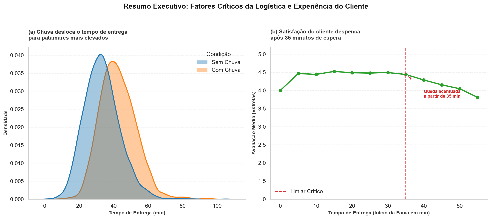

# Chuva aumenta em 9 minutos o tempo de entrega e reduz a satisfação do cliente: diagnóstico de 8.058 pedidos de delivery em 2024

## Resumo Executivo

Este projeto realizou uma Análise Exploratória de Dados (EDA) sobre uma base de 8.058 pedidos de delivery realizados ao longo de 2024 nas cidades de São Paulo, Rio de Janeiro e Belo Horizonte. 

O objetivo foi identificar fatores que impactam a eficiência operacional, a satisfação dos clientes e os resultados comerciais para apoiar decisões estratégicas e operacionais em 2025. 

Os resultados mostram que a chuva aumenta significativamente os tempos de entrega, que atrasos reduzem a avaliação dos clientes e que cupons são utilizados principalmente como ferramenta de aquisição de novos usuários. 

## Figura Principal



**Principais resultados**

- A chuva aumenta o tempo médio de entrega em aproximadamente 9 minutos. 
- Quase metade dos pedidos (48,7%) demora mais de 35 minutos para ser entregue. 
- A satisfação do cliente diminui conforme o tempo de entrega aumenta. 
- Pedidos com cupom apresentam ticket mediano menor. 
- Clientes novos usam cupons muito mais frequentemente que clientes recorrentes. 

---

# Problema de Negócio

A diretoria da empresa deseja compreender:

- Como melhorar a eficiência operacional das entregas;
- Quais fatores impactam a satisfação dos clientes;
- Como otimizar campanhas promocionais;
- Onde concentrar investimentos para crescimento sustentável em 2025.

Para responder a essas questões foram formuladas hipóteses estatísticas relacionadas a clima, cupons, experiência do cliente, categorias de restaurantes e meios de pagamento. 

---

# Dados Utilizados

## Base

| Item | Valor |
|--------|--------|
| Período | Janeiro a dezembro de 2024 |
| Registros | 8.058 pedidos |
| Colunas originais | 18 |
| Registros duplicados | 0 |
| Pedidos duplicados | 0 |

【1-ff6e28】

## Variáveis de interesse

| Variável | Descrição |
|-----------|-----------|
| valor_pedido | Valor total da compra |
| tempo_entrega_min | Tempo de entrega em minutos |
| avaliacao | Nota atribuída pelo cliente |
| cupom | Uso de cupom promocional |
| cliente_novo | Indica primeiro pedido do cliente |
| cidade | Cidade do pedido |
| forma_pagamento | Método de pagamento |
| tipo_cozinha | Categoria do restaurante |
| chuva | Condição climática |

---

# Limpeza e Tratamento dos Dados

## Problemas identificados

- Tipos incorretos em campos monetários. 【1-ff6e28】
- Datas armazenadas como texto. 【1-ff6e28】
- 13 grafias diferentes para cidades. 【1-ff6e28】
- 8 grafias diferentes para formas de pagamento. 【1-ff6e28】
- Ausência de avaliações em 1.342 pedidos. 【1-ff6e28】
- Distâncias ausentes em 315 pedidos. 【1-ff6e28】
- Plataforma ausente em 153 pedidos. 【1-ff6e28】
- Tempos de entrega inválidos. 【1-ff6e28】
- Distâncias impossíveis. 【1-ff6e28】

## Decisões adotadas

| Problema | Quantidade | Tratamento |
|-----------|-----------:|-----------|
| Tempo = 999 min | 25 | Convertido para NaN |
| Tempo negativo | 8 | Convertido para NaN |
| Distância > 100 km | 7 | Convertida para NaN |
| Avaliações ausentes | 1.342 | Mantidas como ausentes |
| Plataforma ausente | 153 | Categoria "Não informada" |
| Variações de cidade | 13 grafias | Padronização |
| Variações de pagamento | 8 grafias | Padronização |

【1-ff6e28】

## Colunas removidas

- pais
- moeda

## Variáveis auxiliares criadas

- data
- mês
- dia da semana
- hora
- tempo_invalido
- distancia_invalida
- pedido_grande

---

# Indicadores Gerais

| Indicador | Valor |
|-----------|-----------|
| Faturamento total | R$ 576.584,75 |
| Ticket médio | R$ 71,55 |
| Ticket mediano | R$ 61,61 |
| Tempo médio de entrega | 35,91 min |
| Avaliação média | 4,35 |
| P50 entrega | 35 min |
| P90 entrega | 50 min |
| P95 entrega | 55 min |
| Pedidos acima de 35 min | 48,70% |
| Pedidos acima de 45 min | 18,39% |
| Pedidos acima de 45 min | 1.476 |

【1-ff6e28】

---

# Como Executar o Projeto

```bash
git clone https://github.com/Amvass/projeto-final-ada.git

cd projeto-final-ada

pip install -r requirements.txt

jupyter notebook projeto_final.ipynb
```

Execute todas as células do notebook:

```text
Kernel > Restart & Run All
```

---

# Análises Visuais

## Impacto da Chuva no Tempo de Entrega


A distribuição dos tempos de entrega desloca-se para valores maiores em dias chuvosos, evidenciando impacto operacional relevante. 【1-ff6e28】

## Tempo de Entrega x Avaliação


As avaliações diminuem gradualmente conforme aumenta o tempo de espera do cliente. 

## Uso Mensal de Cupons


Julho apresentou comportamento atípico, alcançando 45,62% dos pedidos com cupom. 

## Clientes Novos x Uso de Cupom


Clientes novos utilizam cupons em frequência muito superior à de clientes recorrentes. 【1-ff6e28】

## Heatmap de Correlação


A associação mais forte observada ocorreu entre distância e tempo de entrega. 

---

# Testes de Hipóteses

| Hipótese | Resultado |
|-----------|-----------|
| H1 – Chuva aumenta o tempo de entrega | ✅ Confirmada |
| H2 – Cupom altera o ticket | ✅ Confirmada |
| H3 – Tempo afeta avaliação | ✅ Confirmada |
| H4 – Tipo de cozinha afeta o ticket | ✅ Confirmada |
| H5 – Cidade influencia pagamento | ❌ Não confirmada |
| H6 – Clientes novos usam mais cupons | ✅ Confirmada |


## H1 – A chuva aumenta o tempo de entrega?

| Métrica | Valor |
|----------|----------|
| Teste | Welch unilateral |
| p-valor | 1,77 × 10⁻¹²¹ |
| Tamanho de efeito | d = 2,00 |
| Diferença observada | +9,03 minutos |

**Conclusão:** a chuva aumenta significativamente o tempo de entrega. 

## H2 – Pedidos com cupom possuem ticket diferente?

| Métrica | Valor |
|----------|----------|
| Teste | Mann-Whitney U |
| p-valor | 3,19 × 10⁻¹⁴ |
| Diferença mediana | -R$ 5,60 |

**Conclusão:** pedidos com cupom apresentam ticket menor. 

## H3 – O tempo de entrega afeta a avaliação?

| Métrica | Valor |
|----------|----------|
| Teste | Spearman + Mann-Whitney |
| p-valor | 1,26 × 10⁻⁶¹ |
| Correlação | -0,24 |
| Diferença mediana | -1 estrela |

**Conclusão:** entregas mais demoradas estão associadas a piores avaliações. 

## H4 – O tipo de cozinha influencia o valor gasto?

| Métrica | Valor |
|----------|----------|
| Teste | Kruskal-Wallis + ANOVA |
| p-valor | < 0,001 |
| ε² | 0,406 |
| η² | 0,151 |

**Conclusão:** existe forte diferença de ticket entre categorias de cozinha. 

## H5 – Forma de pagamento depende da cidade?

| Métrica | Valor |
|----------|----------|
| Teste | Qui-quadrado |
| p-valor | 0,695 |
| V de Cramér | 0,0155 |

**Conclusão:** não existe associação relevante entre cidade e forma de pagamento. 

## H6 – Clientes novos usam mais cupons?

| Métrica | Valor |
|----------|----------|
| Teste | Qui-quadrado de independência |
| p-valor | 2,42 × 10⁻⁹⁶ |
| V de Cramér | 0,23 |
| Diferença | +25,1 p.p. |

**Conclusão:** clientes novos utilizam cupons significativamente mais que clientes recorrentes. 

---

# Principais Achados

1. **A chuva é o principal fator operacional identificado**, aumentando em média 9 minutos o tempo de entrega. 

2. **A satisfação diminui quando o tempo de entrega aumenta**, com correlação negativa estatisticamente significativa. 

3. **A operação possui oportunidade de melhoria**, pois quase metade dos pedidos ultrapassa 35 minutos. 

4. **Cupons funcionam principalmente como mecanismo de aquisição**, especialmente entre novos clientes. 

5. **Os meios de pagamento possuem comportamento semelhante nas três cidades analisadas.** 

---

# Recomendações

## 1. Reforçar a operação em dias chuvosos

- Planejamento de capacidade;
- Aumento da oferta de entregadores;
- Monitoramento climático;
- Ajuste das metas de SLA.

**Indicador:** tempo médio de entrega em dias chuvosos. 

## 2. Reduzir entregas acima de 35 minutos

Meta sugerida:

> Reduzir de 48,7% para menos de 30%.

**Indicador:** percentual de entregas acima de 35 minutos. 

## 3. Utilizar cupons com foco em aquisição

Monitorar:

- Conversão;
- CAC;
- Taxa de recompra.

【1-ff6e28】

---

# Limitações

- Dados limitados ao ano de 2024. 
- Ausência de custos promocionais. 
- Ausência de dados operacionais dos entregadores. 
- Não é possível estabelecer causalidade, apenas associação. 
- Não há histórico para avaliação de retenção. 

---

# Próximos Passos

- Construir modelos preditivos de atraso.
- Avaliar retorno financeiro de cupons.
- Estudar retenção e recorrência de clientes.
- Incorporar múltiplos anos de dados.
- Desenvolver dashboards executivos.

【1-ff6e28】

---

# Tecnologias Utilizadas

- Python
- Pandas
- NumPy
- Matplotlib
- Seaborn
- SciPy
- Jupyter Notebook

---

# Estrutura do Projeto

```text
projeto-final-ada/
│
├── projeto_final.ipynb
├── README.md
├── dados/
│   └── delivery_pedidos.csv
│
├── saidas/
│   ├── delivery_pedidos_limpo.csv
│   ├── figura_principal.png
│   └── graficos/
│
└── requirements.txt
```

---

# Autor

**Américo Vass Filho**

GitHub: https://github.com/Amvass

Projeto desenvolvido como trabalho final da formação em Análise e Tratamento de Dados.